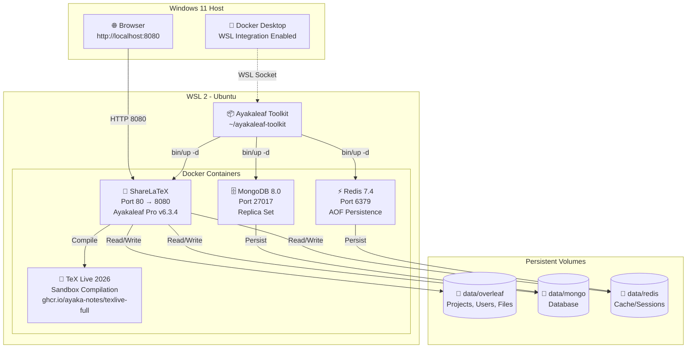
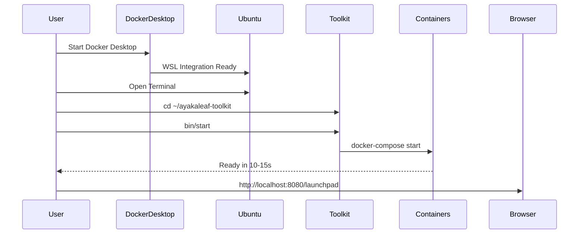

# Ayakaleaf Pro - Complete End-to-End Tutorial

> **A local, open-source alternative to Overleaf running 100% on Windows 11 via WSL 2 + Docker Desktop**

---

## 📋 Table of Contents

1. [Overview](#overview)
2. [Architecture](#architecture)
3. [Prerequisites](#prerequisites)
4. [Step-by-Step Installation](#step-by-step-installation)
5. [Verification & First Use](#verification--first-use)
6. [Daily Operations](#daily-operations)
7. [Troubleshooting Guide](#troubleshooting-guide)
8. [Backup & Recovery](#backup--recovery)

---

## 🎯 Overview

| Component | Technology | Purpose |
|-----------|------------|---------|
| **OS Virtualization** | WSL 2 (Ubuntu) | Linux kernel on Windows |
| **Container Runtime** | Docker Desktop | Container orchestration |
| **Application** | Ayakaleaf Pro (Overleaf Server Pro fork) | LaTeX editor + collaboration |
| **Database** | MongoDB 8.0 | Document storage |
| **Cache/Queue** | Redis 7.4 | Sessions, caching, real-time |
| **LaTeX Engine** | TeX Live 2026 (Docker) | Sandbox compilation |

### What You'll Get
- ✅ Full LaTeX editing in browser
- ✅ Real-time collaboration
- ✅ PDF preview with auto-recompile
- ✅ Project version history
- ✅ 100% local - no internet required after setup
- ✅ Data persists across restarts

---

## 🏗 Architecture



---

## ✅ Prerequisites

### Hardware Requirements

| Use Case | CPU | RAM | Storage |
|----------|-----|-----|---------|
| **Minimum** | 2 cores | 3 GB | 40 GB |
| **Recommended (Personal)** | 4+ cores | 8 GB | 80 GB |
| **Recommended (Team)** | 8+ cores | 16 GB | 256 GB |

> **Note**: TeX Live 2026 Full image ≈ 10 GB. Allow 40 GB for image + app + future updates.

### Software Requirements

| Software | Version | Source |
|----------|---------|--------|
| Windows 11 | 22H2+ | Windows Update |
| WSL 2 | Latest | `wsl --install` |
| Ubuntu | 22.04/24.04 | Microsoft Store / WSL |
| Docker Desktop | 4.30+ | [docker.com](https://www.docker.com/products/docker-desktop/) |
| Git | Latest | [git-scm.com](https://git-scm.com/) |

---

## 🚀 Step-by-Step Installation

### Phase 1: Windows Environment Setup

#### 1.1 Install WSL 2 + Ubuntu

```powershell
# Run as Administrator
wsl --install -d Ubuntu
# Restart Windows when prompted
```

**Post-install verification:**
```powershell
wsl --update
wsl --version          # Must show VERSION 2
wsl --list --verbose   # Ubuntu must show VERSION 2
```

If Ubuntu shows VERSION 1:
```powershell
wsl --set-version Ubuntu 2
```

#### 1.2 Install & Configure Docker Desktop

1. Download [Docker Desktop for Windows](https://docs.docker.com/desktop/setup/install/windows-install/)
2. Run installer → Choose **WSL 2 backend**
3. Open Docker Desktop → Wait for engine to start
4. **Settings → General** → ✅ "Use WSL 2 based engine"
5. **Settings → Resources → WSL Integration** → ✅ **Ubuntu** → **Apply & Restart**

#### 1.3 Verify Docker from Ubuntu

```bash
# Open Ubuntu terminal from Start menu
docker version           # Must show Client AND Server
docker compose version   # v2.x
docker ps                # Empty list is OK
```

**Expected output:**
```
Client: Docker Engine - Community
 Version:           28.x.x
Server: Docker Desktop
 Engine:
  Version:          28.x.x
```

> **⚠️ CRITICAL**: If you get "docker: command not found" or "Cannot connect to Docker daemon", Docker Desktop WSL Integration is not enabled for Ubuntu. Fix:
> 1. Open Docker Desktop → Settings → Resources → WSL Integration
> 2. ✅ Check **Ubuntu** → **Apply & Restart**
> 3. Reopen Ubuntu terminal and verify `docker version` shows both Client and Server

#### 1.4 Check Resources & Docker Socket

```bash
docker info --format 'CPUs={{.NCPU}} Memory={{.MemTotal}}'
df -h "$HOME"
ls -l /var/run/docker.sock
```

> **🔧 FIX - Docker Socket in Ubuntu**: If `/var/run/docker.sock` doesn't exist in Ubuntu but Docker works from Windows, create the symlink:
> ```bash
> sudo ln -sf /mnt/wsl/docker-desktop/shared-sockets/host-services/docker.proxy.sock /var/run/docker.sock
> sudo chown root:docker /var/run/docker.sock
> ```
> This is required because Docker Desktop's WSL 2 backend exposes the socket at a different path than the standard `/var/run/docker.sock`.

| Resource | Minimum | Recommended |
|----------|---------|-------------|
| CPUs | 2 | 4+ |
| Memory | 4 GB | 8 GB |
| Disk (home) | 40 GB | 80 GB |

> **Important**: Keep `DOCKER_SOCKET_PATH=/var/run/docker.sock` in config. Never `chmod 777` the socket.

---

### Phase 2: Toolkit Setup

#### 2.1 Clone Ayakaleaf Toolkit

```bash
# In Ubuntu terminal
cd ~
git clone https://github.com/ayaka-notes/toolkit.git ayakaleaf-toolkit
cd ayakaleaf-toolkit
git checkout master
```

#### 2.2 Fix Line Endings (Critical!)

```bash
# All scripts must use LF (not CRLF)
find . -type f -name "*.sh" -exec sed -i 's/\r$//' {} \;
find bin -type f -exec sed -i 's/\r$//' {} \;
find lib -type f -name "*.sh" -exec sed -i 's/\r$//' {} \;
```

#### 2.3 Fix `read_configuration` Function (Required for MongoDB 8.0)

The toolkit's `lib/shared-functions.sh` has a broken `read_configuration` function that fails to parse `MONGO_VERSION=8.0` correctly. **Apply this fix before running `bin/up -d`:**

```bash
# Backup original
cp lib/shared-functions.sh lib/shared-functions.sh.backup

# Fix the read_configuration function (lines ~223-240)
sed -i '/^function read_configuration() {/,/^}/c\
function read_configuration() {\
  local name=$1\
  local line\
  line=$(grep -E "^$name=" "$TOOLKIT_ROOT/config/overleaf.rc")\
  if [[ -z "$line" ]]; then\
    return\
  fi\
  line=${line#*=}\
  line=${line#\"}\
  line=${line%\"}\
  line=${line#'"'"'}\
  line=${line%'"'"'}\
  echo "$line"\
}' lib/shared-functions.sh

# Verify fix
cd ~/ayakaleaf-toolkit
TOOLKIT_ROOT=/home/shadm/ayakaleaf-toolkit bash -c 'source lib/shared-functions.sh; read_configuration MONGO_VERSION'
# Should output: 8.0
```

> **Why this is needed**: The original regex `s/^$name=(["']?)(.+)\1$/\2/` fails to strip quotes properly, causing `MONGO_VERSION=8.0` to be read as `MONGO_VERSION=8.0` (with quotes), which then fails the version validation `^([0-9]+)\.(.+)$`.

#### 2.3 Install Dependencies

```bash
# Ubuntu base image may need these
sudo apt-get update && sudo apt-get install -y bash openssl
```

#### 2.4 Run Doctor Check

```bash
bin/doctor
```

**Expected warnings (OK to ignore):**
- `lsb_release not found` → cosmetic
- `quay.io not logged in` → expected (we use ghcr.io)

---

### Phase 3: Configuration

#### 3.1 Create Configuration Files

```bash
# Initialize config templates
bin/init
```

**If `bin/init` fails (config exists), that's fine - edit manually.**

#### 3.2 Configure `config/overleaf.rc`

```bash
# Edit with nano (preserves LF endings)
nano config/overleaf.rc
```

**Required settings:**
```bash
#### Overleaf RC ####
PROJECT_NAME=ayakaleaf-wsl
OVERLEAF_DATA_PATH=data/overleaf
SERVER_PRO=true                    # ← Enables Ayakaleaf Pro
OVERLEAF_LISTEN_IP=127.0.0.1
OVERLEAF_PORT=8080
SIBLING_CONTAINERS_ENABLED=true
DOCKER_SOCKET_PATH=/var/run/docker.sock

MONGO_ENABLED=true
MONGO_DATA_PATH=data/mongo
MONGO_IMAGE=mongo
MONGO_VERSION=8.0                  # ← Must be 8.0+ for Ayakaleaf Pro (NOT 7.0!)

REDIS_ENABLED=true
REDIS_DATA_PATH=data/redis
REDIS_IMAGE=redis:7.4
REDIS_AOF_PERSISTENCE=true
```

#### 3.3 Configure `config/variables.env`

```bash
nano config/variables.env
```

**Required settings:**
```bash
# Application
OVERLEAF_SITE_URL=http://localhost:8080
OVERLEAF_APP_NAME="Ayakaleaf Pro"
EMAIL_CONFIRMATION_DISABLED=true

# TeX Live (Full - recommended)
TEX_LIVE_DOCKER_IMAGE=ghcr.io/ayaka-notes/texlive-full:2026.1
ALL_TEX_LIVE_DOCKER_IMAGES=ghcr.io/ayaka-notes/texlive-full:2026.1
ALL_TEX_LIVE_DOCKER_IMAGE_NAMES="TeX Live 2026"

# Sandboxed Compilation (required for Ayakaleaf Pro)
SANDBOXED_COMPILES=true
SANDBOXED_COMPILES_SIBLING_CONTAINERS=true
SANDBOXED_COMPILES_HOST_DIR=/home/shadm/ayakaleaf-toolkit/data/overleaf/data/compiles
DOCKER_RUNNER=true

# Secrets (generate once, keep forever!)
OVERLEAF_SESSION_SECRET=<generate with: openssl rand -hex 32>
OVERLEAF_INVITE_TOKEN_SECRET=<generate with: openssl rand -base64 32>
```

**Generate secrets:**
```bash
openssl rand -hex 32      # → SESSION_SECRET (64 hex chars)
openssl rand -base64 32   # → INVITE_TOKEN_SECRET (base64 encoded)
```

> **⚠️ CRITICAL**: Both secrets MUST be set. Missing `OVERLEAF_INVITE_TOKEN_SECRET` causes startup failure with "Missing required secrets". Missing `OVERLEAF_SESSION_SECRET` breaks session handling.

#### 3.4 Create Version File

```bash
echo "6.3.4" > config/version
```

---

### Phase 4: First Launch

#### 4.1 Start the Stack

```bash
cd ~/ayakaleaf-toolkit
bin/up -d
```

**What happens (takes 5-15 minutes first time):**
1. 📥 Pulls MongoDB 8.0 image
2. 📥 Pulls Redis 7.4 image  
3. 📥 Pulls Ayakaleaf Pro image
4. 📥 **Pulls TeX Live 2026 Full (~10 GB)** ← Longest step
5. 🔧 Starts MongoDB + initiates replica set
6. 🔧 Starts Redis
7. 🔧 Starts ShareLaTeX (Ayakaleaf Pro)

**Monitor progress:**
```bash
# In another terminal
bin/docker-compose logs -f sharelatex
bin/docker-compose logs -f mongo
```

#### 4.1b Startup Race Condition Fix (Critical!)

**Problem**: ShareLaTeX services start before Redis is fully ready, causing `ENOTFOUND redis` errors and restart loops.

**Solution**: After `bin/up -d` completes, wait for Redis to be healthy, then restart sharelatex:

```bash
# Wait for all containers to show healthy/running
docker ps
# Wait until mongo shows "(healthy)" and redis shows "Up"

# Force restart sharelatex to reconnect to ready Redis
bin/docker-compose restart sharelatex

# Wait 10-15 seconds, then verify
docker ps
curl -I http://localhost:8080/launchpad
```

> **Why**: On first startup, Redis takes ~10-15s to fully initialize. ShareLaTeX's Node.js services try to connect immediately and fail, triggering runit to restart the container. A manual restart after Redis is ready resolves this permanently.

#### 4.2 Verify Containers

```bash
bin/docker-compose ps
```

**Expected output:**
```
NAME                IMAGE                                    STATUS                    PORTS
mongo               mongo:8.0                                Up (healthy)              27017/tcp
redis               redis:7.4                                Up                        6379/tcp
sharelatex          ghcr.io/ayaka-notes/overleaf-pro:6.3.4   Up                        127.0.0.1:8080->80/tcp
```

#### 4.3 Verify Web Access

```bash
# From Ubuntu
curl -I http://localhost:8080/launchpad

# From Windows PowerShell
curl.exe -I http://localhost:8080/launchpad
```

**Success = HTTP 200 OK**

---

### Phase 5: First Use & Admin Creation

#### 5.1 Open Launchpad

**In Windows Browser:** `http://localhost:8080/launchpad`

#### 5.2 Create Administrator Account

1. Click **"Register"** or go directly to `/register`
2. Fill in:
   - **Name:** Your Name
   - **Email:** `admin@local` (any email works locally)
   - **Password:** Strong password
3. Click **Register**
4. **First user becomes Administrator automatically**

#### 5.3 Verify Compilation

Create a test project:

```latex
% main.tex - pdfLaTeX test
\documentclass{article}
\begin{document}
Ayakaleaf Pro on Windows WSL 2.
\end{document}
```

Click **Recompile** → PDF should appear.

**Advanced test (XeLaTeX):**
```latex
\documentclass{article}
\usepackage{fontspec}
\begin{document}
Ayakaleaf WSL XeLaTeX sandbox.
\end{document}
```

**Chinese test (requires ctex):**
```latex
\documentclass{ctexart}
\begin{document}
你好，Ayakaleaf Pro。
\end{document}
```

#### 5.4 Confirm Sandbox Compilation

```bash
# Run during compilation
docker ps -a --filter ancestor=ghcr.io/ayaka-notes/texlive-full:2026.1
bin/logs -f clsi
```

You should see a compiler container with the TeX Live image and `/compile` bind mount.

---

## 🔄 Daily Operations

### Startup Sequence



### Command Reference

| Task | Command | When to Use |
|------|---------|-------------|
| **Start (existing)** | `bin/start` | Daily startup |
| **Start (first/config change)** | `bin/up -d` | First run or after config edit |
| **Stop (keep data)** | `bin/stop` | End of day |
| **Restart** | `bin/stop && bin/start` | Quick recycle |
| **Status** | `bin/docker-compose ps` | Check health |
| **Logs - App** | `bin/docker-compose logs --tail=100 sharelatex` | Debug app |
| **Logs - MongoDB** | `bin/docker-compose logs --tail=100 mongo` | Debug DB |
| **Logs - Compiler** | `bin/logs -f clsi` | Watch compilation |
| **Apply config** | `bin/up -d` | After editing config/ |

### Reliable Start Commands (Windows PowerShell)

| Scenario | Command | Notes |
|----------|---------|-------|
| **Daily start** (containers stopped) | `wsl -d Ubuntu -- bash -c "cd /home/shadm/ayakaleaf-toolkit && bash bin/start"` | Fast (~10s), data persists |
| **First run / config change** | `wsl -d Ubuntu -- bash -c "cd /home/shadm/ayakaleaf-toolkit && bash bin/up -d"` | Pulls images, applies config (~30-60s) |
| **After crash / bad state** | `wsl -d Ubuntu -- bash -c "cd /home/shadm/ayakaleaf-toolkit && bash bin/up -d && bash bin/docker-compose restart sharelatex"` | Fixes Redis race condition |
| **Complete reset** | `wsl -d Ubuntu -- bash -c "cd /home/shadm/ayakaleaf-toolkit && bash bin/stop && rm -rf data/ && bash bin/up -d"` | ⚠️ DELETES ALL DATA |

### Quick Status Check

```powershell
# Check container health
wsl -d Ubuntu -- bash -c "cd /home/shadm/ayakaleaf-toolkit && bash bin/docker-compose ps"

# Test web access
curl.exe -I http://localhost:8080/launchpad
# Should return: HTTP/1.1 302 Found (redirects to /login)
```

### PowerShell Shortcuts (Optional)

Add to PowerShell profile (`notepad $PROFILE`):

```powershell
function Ayaka-Start {
    Write-Host "Starting Ayakaleaf Pro..." -ForegroundColor Green
    wsl -d Ubuntu -- bash -c "cd /home/shadm/ayakaleaf-toolkit && bash bin/start"
    Start-Sleep 10
    Write-Host "Opening http://localhost:8080/launchpad" -ForegroundColor Cyan
    Start-Process "http://localhost:8080/launchpad"
}

function Ayaka-Stop {
    Write-Host "Stopping Ayakaleaf Pro..." -ForegroundColor Yellow
    wsl -d Ubuntu -- bash -c "cd /home/shadm/ayakaleaf-toolkit && bash bin/stop"
}

function Ayaka-Status {
    wsl -d Ubuntu -- bash -c "cd /home/shadm/ayakaleaf-toolkit && bash bin/docker-compose ps"
}

function Ayaka-Restart {
    Ayaka-Stop
    Start-Sleep 3
    Ayaka-Start
}
```

**Usage:**
```powershell
Ayaka-Start    # Start + open browser
Ayaka-Stop     # Stop gracefully
Ayaka-Status   # Check containers
Ayaka-Restart  # Full restart
```

---

## 🛠 Troubleshooting Guide

### Quick Diagnostic

```bash
# Run full health check
bin/doctor

# Check container status
bin/docker-compose ps

# Check logs for errors
bin/docker-compose logs --tail=50 sharelatex
bin/docker-compose logs --tail=50 mongo
```

### Common Issues & Solutions

| Symptom | Cause | Solution |
|---------|-------|----------|
| **"localhost refused to connect"** | Containers not ready | Wait 30-60s after `bin/up -d` / `bin/start` |
| **"docker: command not found"** | WSL Integration disabled | Docker Desktop → Settings → Resources → WSL Integration → ✅ Ubuntu → Apply & Restart |
| **"Invalid MONGO_VERSION"** | Version format wrong | Use `MONGO_VERSION=8.0` (major.minor) — **NOT 7.0!** |
| **"Missing required secrets"** | Secrets not set | Add `OVERLEAF_SESSION_SECRET` and `OVERLEAF_INVITE_TOKEN_SECRET` to `variables.env` |
| **"MongoDB requires 8.0+"** | Old Mongo version | Set `MONGO_VERSION=8.0` in `overleaf.rc` (NOT 7.0!) |
| **"ENOTFOUND redis"** | Redis not ready at startup | Wait for Redis healthy, then `bin/docker-compose restart sharelatex` |
| **"403 Forbidden on register"** | Invite-only mode | First user auto-becomes admin; try again |
| **"502 Bad Gateway"** | Nginx upstream down | Check `bin/docker-compose logs sharelatex`; ensure services running |
| **CRLF line ending errors** | Windows editor used | Use `nano` in Ubuntu or `sed -i 's/\r$//' file` |
| **TeX Live pull stuck** | Network/size | Wait - it's ~10 GB. Check `docker ps` for progress |
| **Container restart loop** | Redis not ready at startup | Wait for Redis healthy, then `bin/docker-compose restart sharelatex` |
| **"bin/doctor: line 11: syntax error"** | CRLF line endings in scripts | Run `find . -type f -exec sed -i 's/\r$//' {} \;` in toolkit dir |
| **"read_configuration: command not found"** | Broken `read_configuration` in shared-functions.sh | Apply sed fix in Phase 2.3 (see above) |
| **MongoDB health check fails** | `mongosh` not in PATH or version mismatch | Ensure `MONGO_VERSION=8.0` in overleaf.rc; healthcheck uses `mongosh` |
| **Docker socket not found in Ubuntu** | Wrong socket path | Create symlink: `sudo ln -sf /mnt/wsl/docker-desktop/shared-sockets/host-services/docker.proxy.sock /var/run/docker.sock` |
| **ShareLaTeX exits with "Missing required secrets"** | `OVERLEAF_INVITE_TOKEN_SECRET` not set | Generate: `openssl rand -base64 32` and add to variables.env |
| **Sandbox compilation fails** | Docker socket permissions | Ensure `www-data` user in `dockeronhost` group; socket `chown root:dockeronhost /var/run/docker.sock` |

### Container Restart Loop Debugging

```bash
# 1. Check if containers are restarting
watch -n 2 'docker ps'

# 2. If sharelatex restarts, check logs
bin/docker-compose logs -f sharelatex | head -100

# 3. Common: MongoDB not healthy yet
bin/docker-compose logs mongo

# 4. Force recreate
bin/docker-compose up -d --force-recreate sharelatex
```

### Network Issues

```bash
# Test Docker socket from container
bin/docker-compose exec sharelatex getent hosts redis
bin/docker-compose exec sharelatex getent hosts mongo

# Test Redis connection
bin/docker-compose exec sharelatex node -e "
const net = require('net');
net.connect({host:'redis',port:6379},()=>{console.log('Redis OK');process.exit(0)})
 .on('error',e=>{console.error('Redis ERR:',e.message);process.exit(1)});
"
```

### Reset Everything (Nuclear Option)

```bash
# ⚠️ DELETES ALL PROJECTS AND DATA
cd ~/ayakaleaf-toolkit
bin/stop
rm -rf data/
bin/up -d
```

---

## 💾 Backup & Recovery

### What to Backup

| Directory | Contains | Frequency |
|-----------|----------|-----------|
| `~/ayakaleaf-toolkit/data/overleaf/` | All projects, users, files | Daily |
| `~/ayakaleaf-toolkit/data/mongo/` | Database | Daily |
| `~/ayakaleaf-toolkit/data/redis/` | Sessions, cache | Optional |
| `~/ayakaleaf-toolkit/config/` | Configuration | On change |

### Backup Script

```bash
#!/bin/bash
# save as ~/backup_ayakaleaf.sh
DATE=$(date +%Y%m%d_%H%M%S)
BACKUP_DIR="$HOME/ayakaleaf_backups/$DATE"

mkdir -p "$BACKUP_DIR"
cd ~/ayakaleaf-toolkit

# Stop for consistent backup (optional but recommended)
bin/stop

# Copy data
cp -r data/overleaf "$BACKUP_DIR/"
cp -r data/mongo "$BACKUP_DIR/"
cp -r config "$BACKUP_DIR/"

# Restart
bin/start

echo "Backup saved to: $BACKUP_DIR"
```

### Restore Procedure

```bash
# 1. Stop containers
bin/stop

# 2. Restore data
rm -rf data/overleaf data/mongo
cp -r ~/ayakaleaf_backups/20240115_120000/overleaf data/
cp -r ~/ayakaleaf_backups/20240115_120000/mongo data/

# 3. Restore config (if needed)
cp -r ~/ayakaleaf_backups/20240115_120000/config/* config/

# 4. Start
bin/up -d
```

### Automated Daily Backup (Windows Task Scheduler)

```powershell
# Run in PowerShell as Admin
$action = New-ScheduledTaskAction -Execute 'wsl.exe' -Argument '-d Ubuntu -- bash -c "cd /home/shadm/ayakaleaf-toolkit && bash ~/backup_ayakaleaf.sh"'
$trigger = New-ScheduledTaskTrigger -Daily -At 3am
Register-ScheduledTask -Action $action -Trigger $trigger -TaskName "Ayakaleaf Backup" -Description "Daily Ayakaleaf Pro backup"
```

---

## 📝 Configuration Reference

### Key Configuration Files

```
~/ayakaleaf-toolkit/
├── config/
│   ├── overleaf.rc           # Container & service config
│   ├── variables.env         # App settings & secrets
│   ├── version               # Toolkit version (6.3.4)
│   └── docker-compose.override.yml  # Optional overrides
├── data/
│   ├── overleaf/             # Projects, files, templates
│   ├── mongo/                # MongoDB data files
│   └── redis/                # Redis AOF/RDB files
└── bin/                      # Management scripts
```

### Environment Variable Quick Reference

| Variable | File | Purpose | Example |
|----------|------|---------|---------|
| `SERVER_PRO` | overleaf.rc | Enable Pro features | `true` |
| `SIBLING_CONTAINERS_ENABLED` | overleaf.rc | Sandbox compiles | `true` |
| `DOCKER_SOCKET_PATH` | overleaf.rc | Docker socket | `/var/run/docker.sock` |
| `MONGO_VERSION` | overleaf.rc | MongoDB version | `8.0` |
| `OVERLEAF_SITE_URL` | variables.env | Public URL | `http://localhost:8080` |
| `TEX_LIVE_DOCKER_IMAGE` | variables.env | TeX Live image | `ghcr.io/ayaka-notes/texlive-full:2026.1` |
| `OVERLEAF_SESSION_SECRET` | variables.env | Session encryption | `openssl rand -hex 32` |
| `OVERLEAF_INVITE_TOKEN_SECRET` | variables.env | Invite tokens | `openssl rand -base64 32` |
| `EMAIL_CONFIRMATION_DISABLED` | variables.env | Skip email verify | `true` |

---

## 🎓 Advanced Topics

### Adding More TeX Live Versions

```bash
# In variables.env
ALL_TEX_LIVE_DOCKER_IMAGES=ghcr.io/ayaka-notes/texlive-full:2026.1,ghcr.io/ayaka-notes/texlive-full:2025.1,ghcr.io/ayaka-notes/texlive-full:2024.1
ALL_TEX_LIVE_DOCKER_IMAGE_NAMES="TeX Live 2026,TeX Live 2025,TeX Live 2024"
```

Then: `bin/up -d` (pulls new images)

### Using Basic TeX Live (Saves Space)

```bash
# In variables.env - replace full with basic
TEX_LIVE_DOCKER_IMAGE=ghcr.io/ayaka-notes/texlive-basic:2026.1
ALL_TEX_LIVE_DOCKER_IMAGES=ghcr.io/ayaka-notes/texlive-basic:2026.1
ALL_TEX_LIVE_DOCKER_IMAGE_NAMES="TeX Live 2026 Basic"
```

> ⚠️ Basic lacks: `ctex`, full font collection, some packages

### Enabling HTTPS (Local Development)

```bash
# 1. Generate certs
mkdir -p config/nginx/certs
openssl req -x509 -newkey rsa:4096 -keyout config/nginx/certs/overleaf_key.pem \
  -out config/nginx/certs/overleaf_certificate.pem -days 365 -nodes \
  -subj "/CN=localhost"

# 2. In overleaf.rc
NGINX_ENABLED=true
TLS_PRIVATE_KEY_PATH=config/nginx/certs/overleaf_key.pem
TLS_CERTIFICATE_PATH=config/nginx/certs/overleaf_certificate.pem
NGINX_HTTP_LISTEN_IP=127.0.0.1
NGINX_TLS_LISTEN_IP=127.0.0.1

# 3. In variables.env
OVERLEAF_SITE_URL=https://localhost:8080
OVERLEAF_BEHIND_PROXY=true
OVERLEAF_SECURE_COOKIE=true

# 4. Restart
bin/up -d
```

### External Access (LAN)

```bash
# In overleaf.rc - change listen IP
OVERLEAF_LISTEN_IP=0.0.0.0
OVERLEAF_PORT=8080

# In variables.env - set your LAN IP
OVERLEAF_SITE_URL=http://192.168.1.100:8080

# Windows Firewall: Allow port 8080 inbound
# Docker Desktop: No changes needed (WSL 2 handles port forwarding)
```

---

## 📚 Resources & Links

| Resource | URL |
|----------|-----|
| **Official Documentation** | https://ayakaleaf-pro.mintlify.site/ |
| **GitHub Repository** | https://github.com/ayaka-notes/ayakaleaf-pro |
| **Toolkit Repository** | https://github.com/ayaka-notes/toolkit |
| **Troubleshooting Guide** | https://ayakaleaf-pro.mintlify.site/on-premises/installation/using-docker-compose/windows/troubleshooting.md |
| **Docker Desktop WSL Guide** | https://docs.docker.com/desktop/wsl/ |
| **TeX Live Images** | https://github.com/ayaka-notes/texlive-full |

---

## ✅ Final Checklist

Before considering installation complete:

- [ ] WSL 2 + Ubuntu installed and updated
- [ ] Docker Desktop running with WSL Integration for Ubuntu
- [ ] `docker version` shows Client + Server from Ubuntu
- [ ] Toolkit cloned to `~/ayakaleaf-toolkit`
- [ ] Line endings fixed (LF only)
- [ ] `config/overleaf.rc` configured with `SERVER_PRO=true`, `MONGO_VERSION=8.0`
- [ ] `config/variables.env` configured with secrets, TeX Live image
- [ ] `config/version` exists (6.3.4)
- [ ] `bin/up -d` completed successfully
- [ ] All 3 containers healthy: `mongo`, `redis`, `sharelatex`
- [ ] `curl -I http://localhost:8080/launchpad` returns **200 OK**
- [ ] Browser opens launchpad successfully
- [ ] Admin account created
- [ ] Test project compiles (pdfLaTeX + XeLaTeX)
- [ ] `bin/stop` → `bin/start` preserves data
- [ ] Backup script tested

---

## 🏁 Conclusion

You now have a **fully functional, local Overleaf alternative** running on Windows 11:

```
┌─────────────────────────────────────────────────────────────┐
│  ✅ Ayakaleaf Pro - Local LaTeX Collaboration Platform      │
├─────────────────────────────────────────────────────────────┤
│  🌐 Access:     http://localhost:8080/launchpad            │
│  📁 Data:       ~/ayakaleaf-toolkit/data/                  │
│  🔧 Config:     ~/ayakaleaf-toolkit/config/                │
│  🐳 Containers: mongo, redis, sharelatex (Ayakaleaf Pro)   │
│  📐 TeX Live:   2026 Full (sandboxed compilation)          │
└─────────────────────────────────────────────────────────────┘
```

**Daily workflow:**
```powershell
Ayaka-Start    # Morning: start + open browser
# ... work on LaTeX projects ...
Ayaka-Stop     # Evening: graceful shutdown
```

**Your data is safe, local, and under your complete control.** 🎉